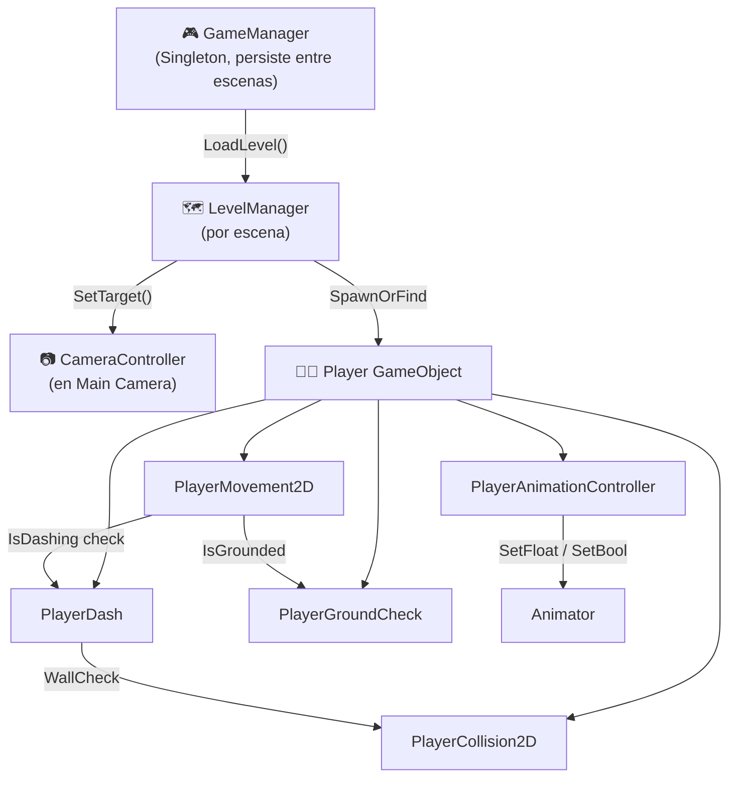

# 🚀 SPACE DUNGEON — Configuración de Niveles 1 y 2
> **Versión:** 1.0 | **Motor:** Unity 6000.3.23f1 | **Pipeline:** URP 2D

---

## 1. Arquitectura Implementada

```
Assets/
├── Script/
│   ├── Player/
│   │   ├── PlayerMovement2D.cs         ← (existente) Movimiento + salto
│   │   ├── PlayerDash.cs               ← (existente) Dash horizontal
│   │   ├── PlayerCollision2D.cs        ← (existente) Detección paredes/techo
│   │   ├── PlayerGroundCheck.cs        ← (existente) Detección suelo
│   │   ├── PlayerAnimationController.cs ← (NUEVO) Gestión del Animator
│   │   └── PlayerAnimatorSetup.cs      ← (NUEVO) Editor utility: crea el AnimatorController
│   │
│   ├── Camera/
│   │   └── CameraController.cs         ← (NUEVO) Seguimiento suave de cámara
│   │
│   ├── Core/
│   │   ├── GameManager.cs              ← (NUEVO) Singleton global (vida, niveles)
│   │   ├── LayerTagSetup.cs            ← (NUEVO) Editor utility: crea tags/layers
│   │   └── SpaceDungeonMenu.cs         ← (NUEVO) Menú unificado de setup en Unity
│   │
│   └── Level/
│       ├── LevelManager.cs             ← (NUEVO) Configurador por escena
│       └── LevelSceneSetup.cs          ← (NUEVO) Editor utility: crea escenas
│
└── Animations/
    └── Player_Animator.controller      ← (se genera desde menú SpaceDungeon/Setup)
```

---

## 2. Conexión entre Sistemas



---

## 3. Scripts Nuevos y Responsabilidades

### `PlayerAnimationController.cs`
- **Propósito:** actualiza los parámetros del `Animator` cada frame según el estado del jugador.
- **Parámetros que escribe:**
  | Parámetro | Tipo | Fuente |
  |-----------|------|--------|
  | `Speed` | Float | `PlayerMovement2D.HorizontalInput` (valor absoluto) |
  | `IsGrounded` | Bool | `PlayerGroundCheck.IsGrounded` |
  | `VerticalVelocity` | Float | `Rigidbody2D.linearVelocity.y` |
- **No contiene lógica de movimiento.** Solo comunica estado al Animator.

### `CameraController.cs`
- **Propósito:** seguimiento suave de cámara sin Cinemachine.
- **Algoritmo:** `Vector3.SmoothDamp` en `LateUpdate`.
- **Configurable:** offset XY, velocidad de suavizado, límites del nivel.
- **Métodos públicos:** `SetTarget()`, `SnapToTarget()`, `SetBounds()`.

### `GameManager.cs`
- **Propósito:** singleton que persiste entre escenas (`DontDestroyOnLoad`).
- **Gestiona:** vida del jugador, índice de nivel activo, navegación entre escenas.
- **Minimal:** no contiene lógica de juego, solo estado y navegación.

### `LevelManager.cs`
- **Propósito:** componente por escena que inicializa el nivel al arrancar.
- **Acciones en `Start()`:** encontrar/instanciar jugador → reposicionarlo → configurar cámara.
- **Dibuja Gizmos:** punto de spawn (esfera verde) y límites del nivel (cubo cian).

---

## 4. Configuración del Astronauta (Player GameObject)

### Jerarquía recomendada del GameObject

```
Player (Tag: Player, Layer: Player)
├── Rigidbody2D
│   ├── Gravity Scale: 3
│   ├── Freeze Rotation Z: ✅
│   └── Interpolate: Interpolate
├── CapsuleCollider2D (body, Layer: Player)
│   ├── Size: (0.3, 0.5)
│   └── Offset: (0, 0)
├── SpriteRenderer
│   └── Sprite: idle 112x26_0
├── Animator
│   └── Controller: Player_Animator.controller
│
├── PlayerMovement2D
├── PlayerDash
├── PlayerAnimationController
│
├── GroundCheck (vacío, posición 0, -0.3)
│   └── PlayerGroundCheck
│       ├── Ground Check: ref a este Transform
│       ├── Check Radius: 0.15
│       └── Ground Layer: Ground
│
└── CollisionChecks (vacío)
    └── PlayerCollision2D
        ├── Wall Check Left Transform: ref a WallCheckLeft
        ├── Wall Check Right Transform: ref a WallCheckRight
        ├── Ceiling Check Transform: ref a CeilingCheck
        └── Ground Layer: Ground
```

### Parámetros de Movimiento

| Parámetro | Valor | Script | Campo |
|-----------|-------|--------|-------|
| Velocidad horizontal | 5 u/s | `PlayerMovement2D` | `moveSpeed` |
| Fuerza de salto | 12 u/s | `PlayerMovement2D` | `jumpForce` |
| Velocidad de dash | 15 u/s | `PlayerDash` | `dashSpeed` |
| Duración del dash | 0.2 s | `PlayerDash` | `dashDuration` |
| Cooldown del dash | 0.8 s | `PlayerDash` | `dashCooldown` |
| Dash en aire | Desactivado | `PlayerDash` | `canDashInAir` |
| Radio detección suelo | 0.15 | `PlayerGroundCheck` | `checkRadius` |
| Gravedad del Rigidbody | 3 | Inspector | Gravity Scale |

### Controles

| Acción | Teclado |
|--------|---------|
| Mover | A / D o Flechas |
| Saltar | Space |
| Dash | Shift izquierdo |

> [!NOTE]
> Los scripts usan el **Legacy Input System** (`Input.GetAxisRaw`, `Input.GetButtonDown`). La migración al nuevo Input System está planificada para un módulo posterior.

---

## 5. Configuración del Animator

### Parámetros del Animator Controller

| Nombre | Tipo | Descripción |
|--------|------|-------------|
| `Speed` | Float | Velocidad horizontal absoluta (0–1) |
| `IsGrounded` | Bool | ¿Está el personaje en el suelo? |
| `VerticalVelocity` | Float | Velocidad vertical del Rigidbody |

### Estados y Clips

| Estado | Clip | Sprite Sheet |
|--------|------|--------------|
| `Idle` | `idle 112x26` | 1 frame, 15×19 px |
| `Run` | `move 112x26` | 8 frames, ~25×23 px promedio |
| `Jump_Rise` | `fire dash 112x26` | 10 frames |
| `Fall` | `damaged 112x26` | frames disponibles |

### Transiciones

| Desde → Hacia | Condición | Exit Time |
|--------------|-----------|-----------|
| Idle → Run | Speed > 0.05 AND IsGrounded | No |
| Run → Idle | Speed < 0.05 AND IsGrounded | No |
| Idle → Jump_Rise | VerticalVelocity > 0.1 AND NOT IsGrounded | No |
| Run → Jump_Rise | VerticalVelocity > 0.1 AND NOT IsGrounded | No |
| Jump_Rise → Fall | VerticalVelocity < 0 | No |
| Fall → Idle | IsGrounded AND Speed < 0.05 | No |
| Fall → Run | IsGrounded AND Speed > 0.05 | No |

> Duración de todas las transiciones: **0.05 s** (blending suave).

---

## 6. Configuración de Cámara

| Parámetro | Valor recomendado |
|-----------|------------------|
| Ortographic Size | 5 |
| Smooth Speed | 6 |
| Offset X | 0 |
| Offset Y | 1 |
| Use Bounds | ✅ (configurado por LevelManager) |

### Límites por nivel

| Nivel | Min X | Max X | Min Y | Max Y |
|-------|-------|-------|-------|-------|
| Nivel 1 | -12 | 80 | -8 | 10 |
| Nivel 2 | -12 | 100 | -8 | 12 |

---

## 7. Configuración de las Escenas

### Nivel 1 — `Level1_AlienPlanet.unity`

| Elemento | Configuración |
|----------|---------------|
| Fondo | Color sólido `(0.05, 0.05, 0.15)` — azul oscuro espacial |
| Spawn | Posición `(-8, 1, 0)` |
| Suelo base | BoxCollider2D en `(0, -2)`, tamaño `200×1` |
| Tileset | `lunar1b_tileset_compact.png` / `lunar1b_tileset_visual.png` |
| Plataformas | `scifi_platform_*` de `Assets/Sprites/transparancies/` |
| Escenario | Tiles `scifi_1a1a` → `scifi_9a3a` de `Assets/Sprites/` |

### Nivel 2 — `Level2_ExtraterrestrialBase.unity`

| Elemento | Configuración |
|----------|---------------|
| Fondo | Color sólido `(0.03, 0.08, 0.05)` — verde oscuro subterráneo |
| Spawn | Posición `(-8, 1, 0)` |
| Suelo base | BoxCollider2D en `(0, -2)`, tamaño `200×1` |
| Tileset | `scifi_*` de categorías 4-9 (base interior) |
| Consolas | `scifi_console_*` de `Assets/Sprites/transparancies/` |
| Plataformas | `scifi_platform_*` y `scifi_stair_*` |

---

## 8. Pasos de Setup en Unity (instrucciones completas)

> [!IMPORTANT]
> Sigue estos pasos **en orden** después de abrir el proyecto en Unity.

### Paso 1 — Configurar Layers y Tags
```
Menú superior: SpaceDungeon → Setup → Configure Layers and Tags
```
Esto crea: Tags `Player`, `Enemy`, `Collectible`, `Ground` y los Layers correspondientes.

### Paso 2 — Crear el Animator Controller
```
Menú superior: SpaceDungeon → Setup → Create Player Animator Controller
```
Genera `Assets/Animations/Player_Animator.controller` con estados y transiciones.

> [!WARNING]
> Los clips de animación deben crearse manualmente desde los spritesheets antes de este paso, o asignarse después al Animator. Ver sección **9. Crear clips de animación**.

### Paso 3 — Crear las escenas de los niveles
```
Menú superior: SpaceDungeon → Setup → Create Level 1 Scene
Menú superior: SpaceDungeon → Setup → Create Level 2 Scene
```
Genera `Assets/Scenes/Level1_AlienPlanet.unity` y `Level2_ExtraterrestrialBase.unity` con la jerarquía básica configurada.

### Paso 4 — Configurar el Player en la SampleScene o niveles
1. Crear un `GameObject` vacío → renombrarlo `Player`.
2. Asignar **Tag: Player** y **Layer: Player**.
3. Añadir componentes en este orden:
   - `Rigidbody2D` (Gravity Scale: 3, Freeze Rotation Z: ✅, Interpolate: Interpolate)
   - `CapsuleCollider2D` (Size: 0.3, 0.5)
   - `SpriteRenderer` (Sprite: `idle 112x26_0`)
   - `Animator` (Controller: `Player_Animator.controller`)
   - `PlayerMovement2D`
   - `PlayerDash`
   - `PlayerAnimationController`
4. Crear child GameObject `GroundCheck` en posición `(0, -0.3, 0)`:
   - Añadir `PlayerGroundCheck`, asignar su propio Transform y Layer `Ground`.
5. Crear child GameObject `CollisionChecks`:
   - Crear children `WallCheckLeft (-0.3, 0, 0)`, `WallCheckRight (0.3, 0, 0)`, `CeilingCheck (0, 0.3, 0)`.
   - Añadir `PlayerCollision2D` al padre, asignar los tres Transforms.
6. En `PlayerMovement2D`: asignar `GroundCheck`, `CollisionCheck`, `PlayerDash`, `SpriteRenderer`.
7. En `PlayerDash`: asignar `PlayerMovement`, `GroundCheck`, `CollisionCheck`.
8. En `PlayerAnimationController`: asignar `PlayerMovement2D` y `PlayerGroundCheck`.

### Paso 5 — Configurar la cámara
1. Seleccionar `Main Camera` en la escena.
2. Añadir componente `CameraController`.
3. Asignar el `Player` como `Target`.
4. Configurar `Offset: (0, 1)` y `Smooth Speed: 6`.

### Paso 6 — Añadir Build Settings
```
File → Build Settings → Add Open Scenes
```
Añadir en orden: `Level1_AlienPlanet`, `Level2_ExtraterrestrialBase`.

---

## 9. Crear Clips de Animación (manual en Unity)

Para cada spritesheet:

1. Seleccionar el PNG en el Project Panel (ej. `move 112x26.png`).
2. Cambiar **Sprite Mode** a **Multiple** si no lo está.
3. Abrir **Sprite Editor** → aplicar **Auto Slice**.
4. Seleccionar todos los sprites generados (`move 112x26_0` → `move 112x26_7`).
5. Arrastrar la selección al **Animator Window** o a la carpeta `Assets/Animations/`.
6. Unity crea automáticamente un clip `.anim`.
7. Ajustar **Sample Rate** a **12 FPS** (valor recomendado para pixel art).
8. Asignar el clip al estado correspondiente en el `Player_Animator.controller`.

| Spritesheet | Clip | Frames | FPS recomendado |
|-------------|------|--------|----------------|
| `idle 112x26.png` | Idle | 1 | 1 |
| `move 112x26.png` | Run | 8 | 12 |
| `fire dash 112x26.png` | Jump_Rise | 10 | 15 |
| `damaged 112x26.png` | Fall | (variable) | 12 |

---

## 10. Archivos Creados o Modificados

| Archivo | Estado | Descripción |
|---------|--------|-------------|
| `Assets/Script/Player/PlayerAnimationController.cs` | ✅ NUEVO | Controlador de animaciones |
| `Assets/Script/Player/PlayerAnimatorSetup.cs` | ✅ NUEVO | Editor: crea el AnimatorController |
| `Assets/Script/Camera/CameraController.cs` | ✅ NUEVO | Seguimiento de cámara |
| `Assets/Script/Core/GameManager.cs` | ✅ NUEVO | Singleton global |
| `Assets/Script/Core/LayerTagSetup.cs` | ✅ NUEVO | Editor: crea layers/tags |
| `Assets/Script/Core/SpaceDungeonMenu.cs` | ✅ NUEVO | Menú de setup en Unity |
| `Assets/Script/Level/LevelManager.cs` | ✅ NUEVO | Configurador de nivel por escena |
| `Assets/Script/Level/LevelSceneSetup.cs` | ✅ NUEVO | Editor: crea las escenas |
| `Assets/Script/Player/PlayerMovement2D.cs` | ✅ SIN CAMBIOS | Movimiento original |
| `Assets/Script/Player/PlayerDash.cs` | ✅ SIN CAMBIOS | Dash original |
| `Assets/Script/Player/PlayerCollision2D.cs` | ✅ SIN CAMBIOS | Colisiones original |
| `Assets/Script/Player/PlayerGroundCheck.cs` | ✅ SIN CAMBIOS | Suelo original |

---

## 11. Validación (checklist)

### Automáticamente verificado
- [x] Coherencia de referencias entre scripts
- [x] Sin clases duplicadas
- [x] Sin modificación de scripts existentes
- [x] Sprites del astronauta identificados y mapeados al Animator

### Verificar desde Unity
| # | Prueba | Cómo verificar |
|---|--------|----------------|
| 1 | Sin errores de compilación | Consola de Unity → 0 errores en rojo |
| 2 | Movimiento horizontal | Play → A/D → el astronauta se mueve |
| 3 | Salto | Play → Space → el astronauta salta y aterriza |
| 4 | Dash | Play → Shift → el astronauta hace dash |
| 5 | No atraviesa el suelo | Play → verificar que Rigidbody2D detiene al personaje en el Collider |
| 6 | Animaciones | Play → verificar que el Animator cambia de estado según movimiento |
| 7 | Cámara sigue al jugador | Play → mover el personaje → cámara sigue suavemente |
| 8 | Límites de cámara | Play → llegar al borde del nivel → cámara se detiene en el límite |
| 9 | LevelManager posiciona spawn | Play en Level1 → jugador aparece en `(-8, 1, 0)` |
| 10 | GameManager persiste | Cambiar de escena → `GameManager.Instance` no es null |

---

## 12. Funcionalidades Pendientes

| Funcionalidad | Módulo sugerido |
|--------------|----------------|
| Clips de animación (crear desde spritesheets) | Módulo Animator |
| Tilemap del Nivel 1 (construcción de escenario) | Módulo Escenarios |
| Tilemap del Nivel 2 (construcción de escenario) | Módulo Escenarios |
| Sistema de combate del astronauta | Módulo Combate |
| IA de enemigos | Módulo Enemigos |
| Sistema de vida + Game Over UI | Módulo UI/HUD |
| Coleccionables (3 componentes de la nave) | Módulo Coleccionables |
| Migración al nuevo Input System | Módulo Input |
| Audio (música + SFX) | Módulo Audio |
| Menú principal | Módulo UI |

---

> [!TIP]
> Para el setup completo en un solo paso: **SpaceDungeon → Setup → Run Full Setup**
> Esto ejecuta en orden: Layers/Tags → Animator → Level 1 → Level 2.
